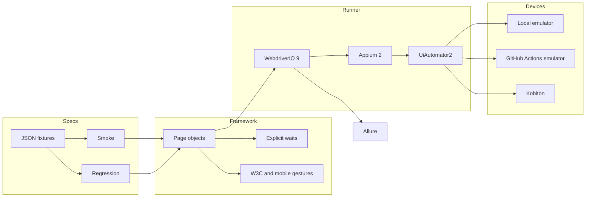
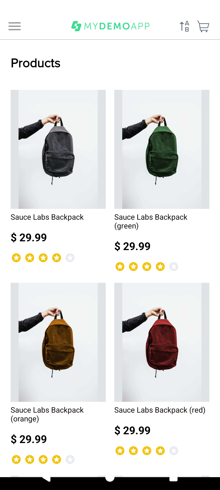
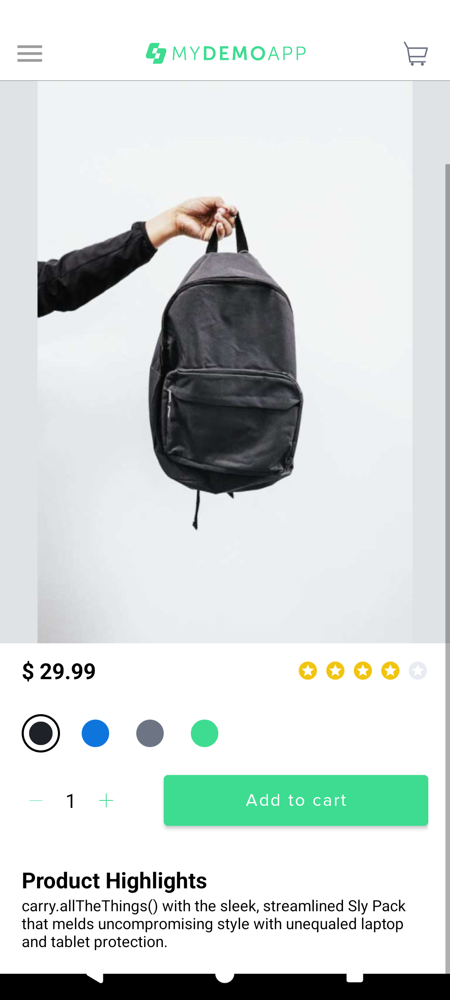
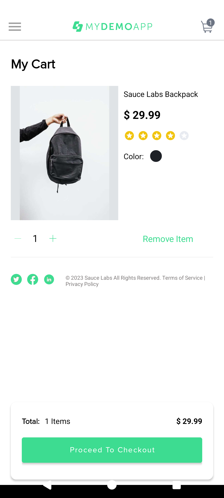
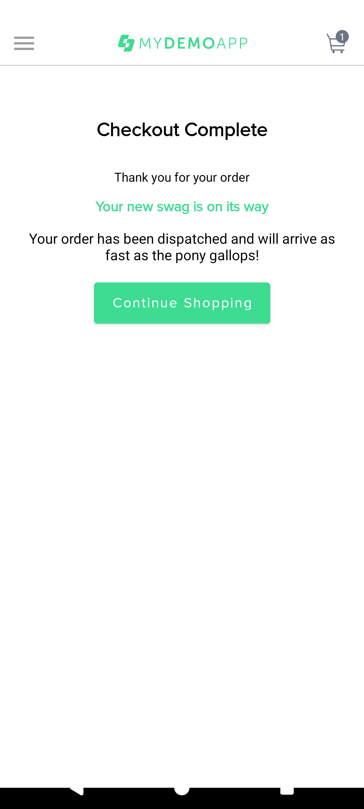
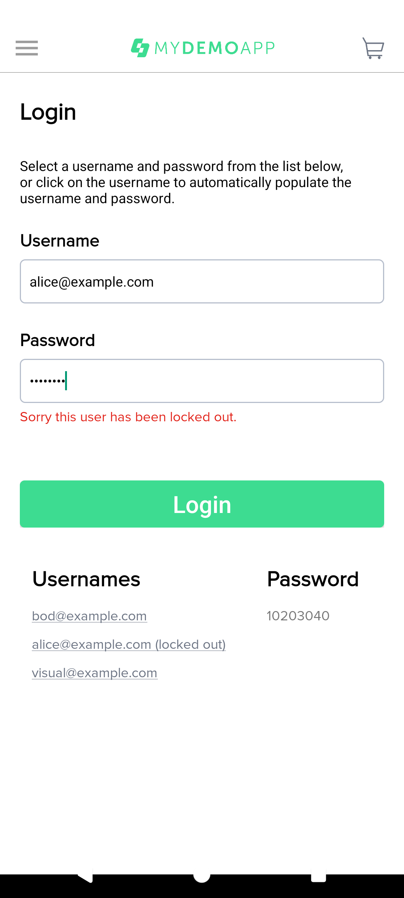
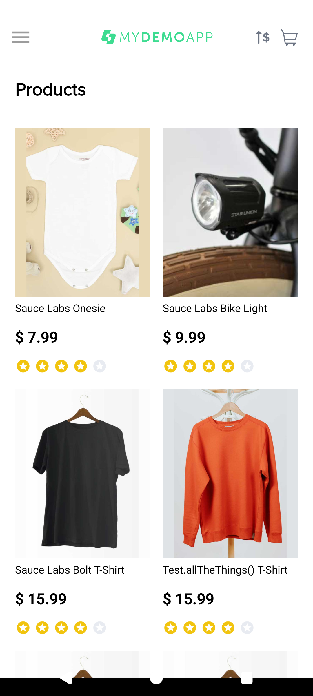

# Appium Mobile Automation

[](https://github.com/hassanmehmoodd/appium-mobile-automation/actions/workflows/android-emulator.yml)
[](https://nodejs.org/)
[](https://appium.io/)
[](https://webdriver.io/)
[](https://www.typescriptlang.org/)
[](LICENSE)

TypeScript UI automation for [Sauce Labs My Demo App Android](https://github.com/saucelabs/my-demo-app-android) 2.3.0. The suite uses **Appium 2** with the **UiAutomator2** driver and the **WebdriverIO 9** Mocha runner. The same page objects run on a local emulator, the GitHub Actions emulator, and Kobiton when credentials are present.

WebdriverIO 10's Appium service declares a peer dependency on Appium 3. This repository stays on WebdriverIO 9.33 so the runner matches Appium 2. `npm run appium:setup` installs UiAutomator2 driver 4.2.9, the newest driver release whose peer range still accepts Appium 2. Later driver majors require Appium 3 or 4.

## What it covers

- Page objects with a shared base screen
- Separate capabilities for a local emulator, the CI emulator, Kobiton, and optional BrowserStack and Sauce Labs configs
- Launch, login, catalog, product details, cart, quantity, checkout, sorting, and menu navigation
- W3C touch actions and UiAutomator2 `mobile:` gestures
- Explicit waits and accessibility-id locators
- JSON data for login failures, products, and checkout
- Allure screenshots and logcat on failure
- `@smoke` and `@regression` tags, plus WebdriverIO suites
- One Mocha retry and one spec-file retry on CI
- ESLint and Prettier

## Architecture



A failing test calls `browser.takeScreenshot()` and `mobile: shell logcat`. Both are attached to the Allure result and written under `screenshots/`.

## Repository layout

```text
config/                 WebdriverIO configs and capabilities
src/screens/            Page objects, including BaseScreen
src/support/            Gestures, waits, fixtures, failure evidence
test/specs/smoke/       Short suite used locally and in CI
test/specs/regression/  Login failures, details, cart, sort, checkout, gestures
test/data/              JSON fixtures
scripts/                APK download and local emulator boot
.github/workflows/      Emulator CI and manual Kobiton workflow
docs/screenshots/       PNGs captured from a real emulator run
```

## Application under test

|         |                                                                                                               |
| ------- | ------------------------------------------------------------------------------------------------------------- |
| App     | Sauce Labs My Demo App Android 2.3.0                                                                          |
| Package | `com.saucelabs.mydemoapp.android`                                                                             |
| APK     | [mda-2.3.0-27.apk](https://github.com/saucelabs/my-demo-app-android/releases/download/2.3.0/mda-2.3.0-27.apk) |
| Source  | https://github.com/saucelabs/my-demo-app-android                                                              |

The source repository does not publish an SPDX license (checked 8 November 2026). This project does not vendor the APK. `npm run app:download` fetches the official release and checks its sha256 when `app-under-test.json` contains one. Do not redistribute the binary.

The Android build signs in as `bod@example.com` / `10203040`. `alice@example.com` is locked out. Any other non-empty password is accepted for a user who is not locked out, so the negative cases assert the errors the app actually shows: missing username, missing password, and the locked account. Adding the plain "Sauce Labs Bolt T-Shirt" forces the quantity to 10 inside the app, so quantity checks use the backpack. Opening "Sauce Labs Bike Light" from the grid crashes the process with a `NullPointerException` in `ProductCatalogFragment` (observed on APK 2.3.0), so the suite does not tap that tile.

## Prerequisites

- Node.js 22 LTS
- JDK 17 or newer
- Android SDK packages: `platform-tools`, `emulator`, `platforms;android-34`, `build-tools;34.0.0`, `system-images;android-34;google_apis;x86_64`
- KVM (`/dev/kvm`) for a hardware-accelerated emulator
- `ANDROID_HOME` pointing at the SDK

```bash
export ANDROID_HOME="$HOME/android-sdk"
export ANDROID_SDK_ROOT="$ANDROID_HOME"
export PATH="$ANDROID_HOME/cmdline-tools/latest/bin:$ANDROID_HOME/platform-tools:$ANDROID_HOME/emulator:$PATH"
```

Accept the SDK licenses, then install the image:

```bash
yes | sdkmanager --licenses
sdkmanager "platform-tools" "emulator" "platforms;android-34" "build-tools;34.0.0" \
  "system-images;android-34;google_apis;x86_64"
```

## Install and run locally

```bash
npm ci
npm run appium:setup
cp .env.example .env
npm run emulator:start
npm run test:smoke
npm run test:regression
npm run report
npm run report:open
```

`npm test` runs smoke and regression together. The emulator script creates an AVD named `mda_api_34` when it is missing, then waits until `sys.boot_completed` is `1`.

| Command                       | What it runs             |
| ----------------------------- | ------------------------ |
| `npm run test:smoke`          | `test/specs/smoke`       |
| `npm run test:regression`     | `test/specs/regression`  |
| `npm run test:tag:smoke`      | Mocha grep `@smoke`      |
| `npm run test:tag:regression` | Mocha grep `@regression` |
| `npm run lint`                | ESLint                   |
| `npm run format`              | Prettier                 |
| `npm run typecheck`           | `tsc --noEmit`           |

Set `DOCS_SCREENSHOTS=1` to write the gallery under `docs/screenshots/` during a run.

## Kobiton

The Kobiton config is a basic Appium 2 session. It is skipped with exit code 0 when `KOBITON_USERNAME` or `KOBITON_API_KEY` is empty. No Kobiton session was executed while this repository was created.

```bash
export KOBITON_USERNAME="your-username"
export KOBITON_API_KEY="your-api-key"
# Optional. Defaults are a wildcard device, the KOBITON public pool, and the official APK URL.
export KOBITON_DEVICE_NAME="Pixel *"
export KOBITON_DEVICE_GROUP="KOBITON"
export KOBITON_APP_URL="https://github.com/saucelabs/my-demo-app-android/releases/download/2.3.0/mda-2.3.0-27.apk"
npm run test:kobiton
```

The hub is `https://api.kobiton.com/wd/hub`. Credentials are sent as `appium:username` and `appium:accessKey`, and as the WebdriverIO `user` / `key` pair. The app capability is `kobiton:app`, which Kobiton requires for a basic Appium 2 session. `kobiton:runtime` is `appium`.

Kobiton documents two AI-assisted features separately from that basic session:

- [flexCorrect](https://docs.kobiton.com/automation-testing/capabilities/add-flexcorrect) is Appium self-healing. It needs `kobiton:flexCorrect` and `kobiton:baselineSessionId`, and Kobiton limits it to Xium sessions. It is not available for basic Appium 2 sessions.
- [scriptless capture](https://docs.kobiton.com/automation-testing/capabilities/available-capabilities) (`kobiton:scriptlessCapture`) marks a session so it can be converted into a Kobiton test case. Kobiton's [basic Appium 2 guide](https://docs.kobiton.com/automation-testing/basic-appium-server/launch-a-basic-appium-2-session) says Scriptless, generated scripts, validations, and flexCorrect are not supported on basic Appium 2 sessions because they depend on Xium.

Those capabilities are left unset here so a Kobiton run stays a normal UiAutomator2 session. Cloud logs are kept at `error` so keys are less likely to be printed. GitHub Actions also masks repository secrets.

BrowserStack and Sauce Labs configs exist and do nothing unless `ENABLE_BROWSERSTACK=true` or `ENABLE_SAUCE=true`. Missing credentials then fail the process instead of starting an anonymous session.

## Continuous integration

[`.github/workflows/android-emulator.yml`](.github/workflows/android-emulator.yml) runs on pushes and pull requests to `main`, and on `workflow_dispatch`. A lint job runs first. The smoke job enables KVM, caches the AVD snapshot with `actions/cache`, boots API 34 through `reactivecircus/android-emulator-runner`, installs Appium 2 and UiAutomator2, and runs `npm run test:smoke:ci`. Mocha retries and spec-file retries are 1 in the CI config and 0 locally. Allure results, the generated report, screenshots, and logs are uploaded even when the suite fails. Concurrency cancels an in-progress run on the same ref.

[`.github/workflows/kobiton.yml`](.github/workflows/kobiton.yml) is `workflow_dispatch` only. It runs the smoke suite only when both Kobiton secrets exist. Otherwise the job logs a skip and succeeds.

## Screenshots

These were captured on the API 34 emulator with `DOCS_SCREENSHOTS=1`.

| Catalog                                     | Product details                                             |
| ------------------------------------------- | ----------------------------------------------------------- |
|  |  |

| Cart                                  | Checkout complete                                               |
| ------------------------------------- | --------------------------------------------------------------- |
|  |  |

| Locked-out login                                        | Price sort                                                  |
| ------------------------------------------------------- | ----------------------------------------------------------- |
|  |  |

A generated Allure summary from the same run is in [`docs/reports/allure-summary.json`](docs/reports/allure-summary.json). Open the HTML report locally with `npm run report && npm run report:open`.

On 8 November 2026, `npm test` on an API 34 Google APIs emulator (`mda_api_34`) finished **17 tests in 11 spec files, all passed**, in 4 minutes 31 seconds. Allure recorded the same 17 passed results. The GitHub Actions emulator run is the badge at the top of this file.

## Author

**Hassan Mehmood**, Senior SQA Automation Engineer

- GitHub: https://github.com/hassanmehmoodd
- LinkedIn: https://www.linkedin.com/in/hassan-mehmood-hm2/

## License

The framework is [MIT](LICENSE), Copyright 2026 Hassan Mehmood. The demo APK remains subject to Sauce Labs' terms.
